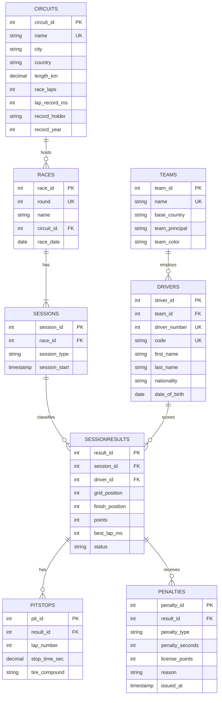

# F1 Management System

Database Systems course project: Flask + PostgreSQL (psycopg2) with a pit-wall style UI.

## Features
- 8 tables in 3NF: teams, drivers, circuits, races, sessions, sessionresults, pitstops, penalties
- Views: View_Driver_Standings, View_Constructor_Standings, View_Race_Calendar
- Fan portal: standings, schedule, circuits, race weekends (FP1-3, Qualifying, Race, pit stops), 11 SQL reports
- Admin desk: teams, drivers, circuits, race calendar, session results, pit stops, FIA penalties
- Parameterised queries only, rollback on every error, constraints enforced in the database

## ER diagram


## Setup (Windows + Ubuntu WSL2)
```bash
sudo apt update
sudo apt install -y python3 python3-venv python3-pip postgresql postgresql-contrib
sudo service postgresql start
sudo -u postgres psql -c "ALTER USER postgres PASSWORD 'postgres';"
sudo -u postgres createdb -E UTF8 -T template0 f1_db
PGPASSWORD=postgres psql -h localhost -U postgres -d f1_db -f schema.sql

python3 -m venv venv
source venv/bin/activate
pip install -r requirements.txt
python app.py
```
Open http://localhost:5000. Admin login: `admin` / `password123` (override with the
`ADMIN_USERNAME` and `ADMIN_PASSWORD` environment variables).

Running `schema.sql` again drops and recreates everything, so it also resets the data.

## Environment variables
`DB_NAME DB_USER DB_PASSWORD DB_HOST DB_PORT SECRET_KEY ADMIN_USERNAME ADMIN_PASSWORD`

## Project structure
```
f1-management-system/
├── schema.sql
├── app.py
├── requirements.txt
├── .gitignore
├── README.md
└── templates/
```